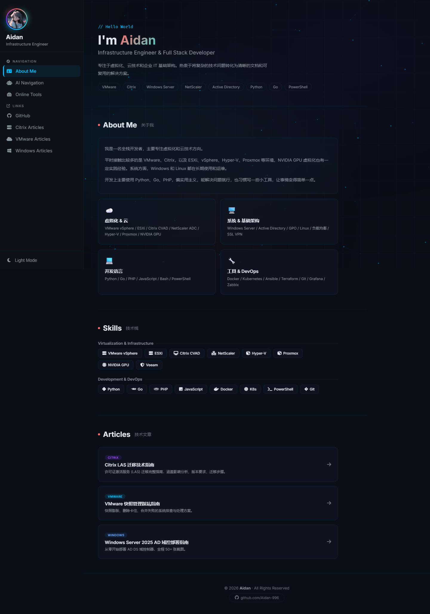
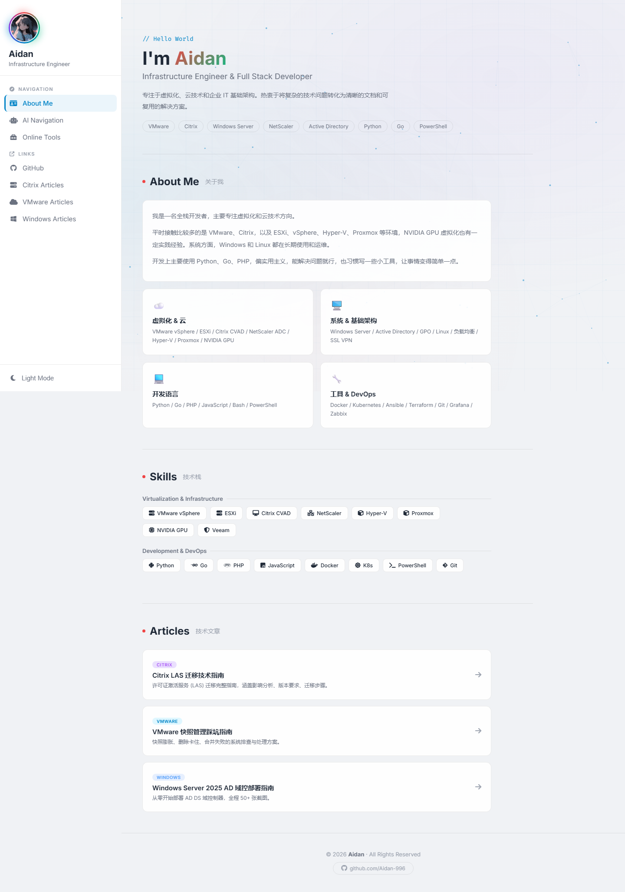
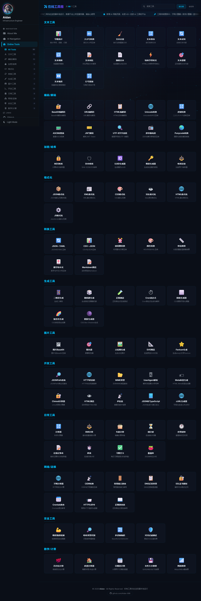
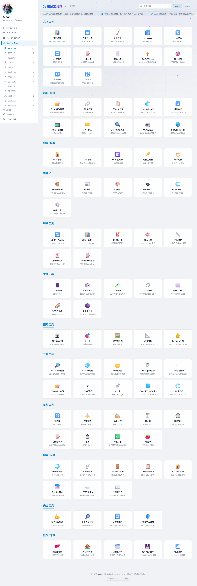
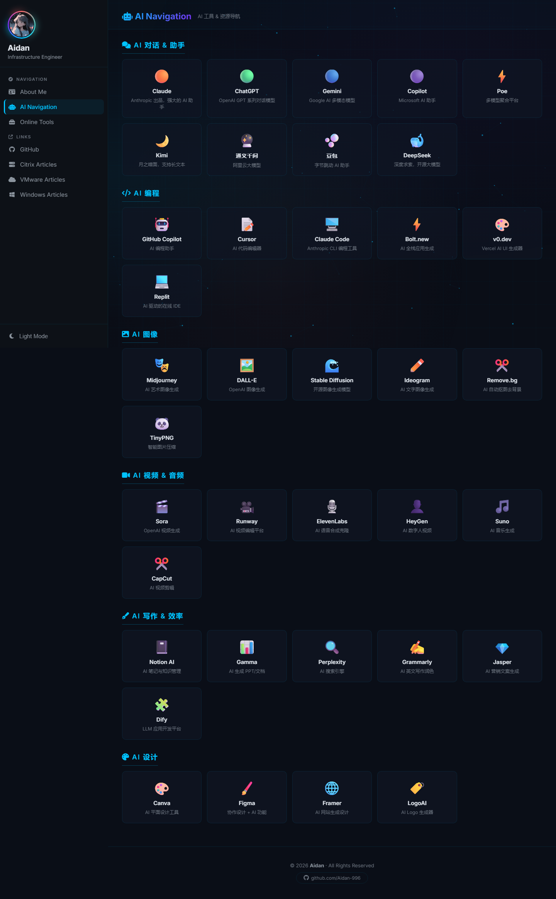
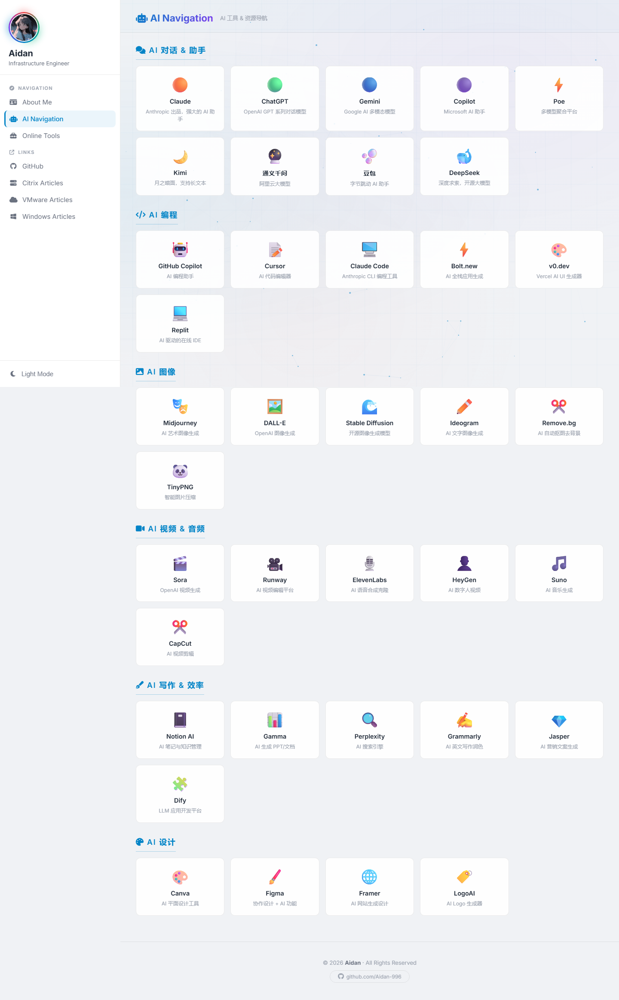

<div align="center">

[](https://git.io/typing-svg)


&nbsp;


</div>


&nbsp;

##  &nbsp;About | 关于

一个集合了 **88+ 实用工具** 和 **40+ AI 平台导航** 的在线工具箱。

所有工具均在浏览器本地运行，数据不会上传至任何服务器，保护你的隐私。支持深色 / 浅色主题切换，左侧导航栏，粒子科技风背景。

&nbsp;

##  &nbsp;Features | 功能特性

<table><tr><td>

**88+ 在线工具**
- 文本处理：字数统计、去重、排序、对比、正则提取
- 编码解码：Base64、URL、HTML、Unicode、JWT、摩尔斯电码
- 加密哈希：MD5、SHA、UUID、密码生成、密码强度检测
- 格式化：JSON、XML、CSS、SQL、HTML、JavaScript
- 转换工具：时间戳、颜色、单位、JSON/YAML、Markdown
- 生成工具：二维码、正则测试、Cron、CSS 圆角/渐变/阴影
- 图片工具：Base64 互转、取色器、SVG 预览、Favicon 生成
- 开发工具：JSONPath、HTTP 状态码、Chmod、cURL 生成器
- 网络运维：子网计算器、CIDR 转换、端口速查、DNS 记录
- 安全工具：密码强度、哈希识别、XSS 过滤、多进制编码
- 数学计算：百分比、房贷计算器、日期差、文件大小、网速换算
- 日常工具：计算器、BMI、倒计时、世界时钟、番茄钟、记事本

</td></tr></table>

<table><tr><td>

**40+ AI 导航**
- AI 对话：Claude、ChatGPT、Gemini、Copilot、Kimi、DeepSeek、通义千问、豆包
- AI 编程：GitHub Copilot、Cursor、Claude Code、Bolt.new、v0.dev、Replit
- AI 图像：Midjourney、DALL-E、Stable Diffusion、Remove.bg
- AI 视频：Sora、Runway、HeyGen、Suno、CapCut
- AI 写作：Notion AI、Gamma、Perplexity、Grammarly、Dify
- AI 设计：Canva、Figma、Framer、LogoAI

</td></tr></table>

<table><tr><td>

**界面特性**
- 左侧固定导航栏，分类清晰
- 深色 / 浅色主题一键切换
- 粒子连线科技风背景 + 鼠标互动
- 头像旋转光环动效
- 工具卡片 hover 放大高亮
- 滚动公告栏
- 返回顶部按钮
- 页面切换动画
- 移动端响应式适配

</td></tr></table>


&nbsp;

##  &nbsp;Screenshots | 界面截图

### About Me - Dark Mode



### About Me - Light Mode



### Online Tools - Dark Mode



### Online Tools - Light Mode



### AI Navigation - Dark Mode



### AI Navigation - Light Mode




&nbsp;

##  &nbsp;Usage | 使用方式

```bash
# Clone the repository
git clone https://github.com/Aidan-996/Website-Tools.git

# Open in browser
# Just open index.html directly - no server needed
```

> No dependencies, no build step, no server. Just open `index.html` in your browser.


&nbsp;

##  &nbsp;License | 版权声明

<table><tr><td>

- All tools run locally in the browser. No data is uploaded to any server.
- 所有工具均在浏览器本地运行，数据不会上传至任何服务器。

</td></tr></table>

<div align="center">

[](https://creativecommons.org/licenses/by-nc-sa/4.0/)

&nbsp;


</div>
